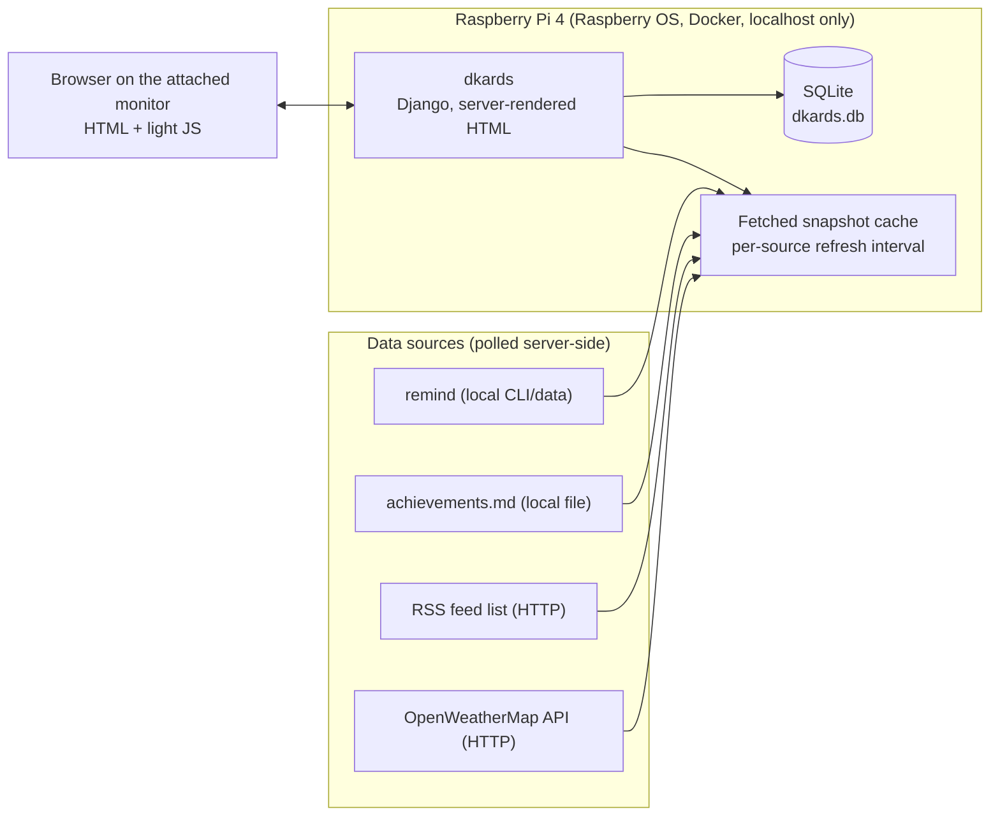
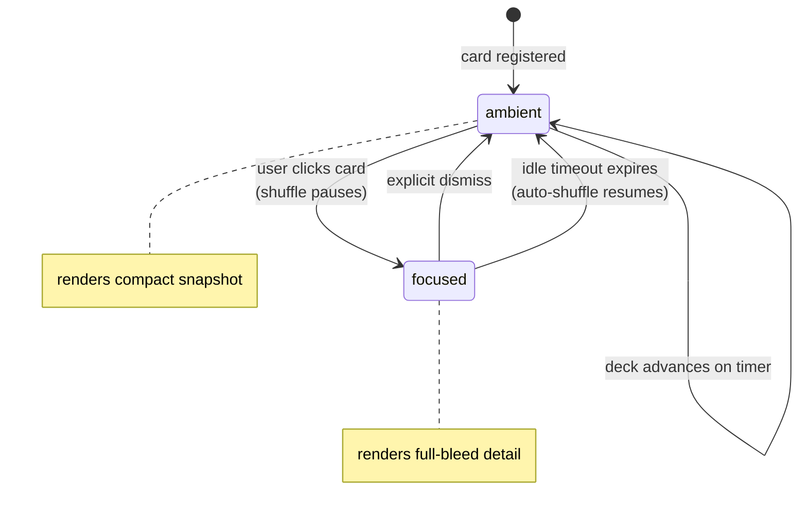

# dkards: The Always-On Deck Carousel

| | |
|---|---|
| **Author** | Tiago |
| **Created** | 2026-10-21 |
| **Status** | draft, awaiting review |
| **Target** | usable v0 by 2026-10-30 |
| **Canonical URL** | none (local document) |

## Objective

Build a self-hosted, always-on carousel of ambient information cards for a spare monitor: a deck that shuffles itself while unattended, pulls any card into focus on click, and resumes on its own, so that glancing at the screen is all it takes to stay informed.

## Background

A side monitor currently driven by a Raspberry Pi running MagicMirror² shows some of this information, but MagicMirror² is an Electron/Node platform built around a physical two-way mirror, and its launcher-style, link-heavy interface does not match what we want: a pure glance appliance with no links out and no hardware requirement. The old LG webOS television card-deck interface is the concrete visual and interaction reference: a horizontal row of cards along the bottom, one card always in focus and rendered full-bleed above the row.

dkards exists to be that appliance. It is a server-rendered Django application with SQLite, no SPA framework, and no outbound links; every card is a self-contained snapshot of data fetched on the server side. This document defines the design of the core deck carousel and the first four cards before implementation starts.

Related documents:

- Project README: [`README.md`](../../README.md)
- Interface mockup: [`mockups/DKARDS.svg`](../../mockups/DKARDS.svg)

## Goals

- A person can glance at the screen and read whatever card is currently in focus, with the full-bleed content fully rendered within one second of a card advancing. No input is ever required.
- All four initial card types (calendar, achievements, RSS news, weather) ship in v0, each supporting both lifecycle states.
- The app runs unattended on a Raspberry Pi 4 for months: a failed fetch, a stale source, or a network outage never takes the deck down or blanks the screen.
- Refresh cadence is configurable per data source, so we can poll a volatile source (weather) and a slow source (achievements file) at rates that fit each one.
- Adding a fifth card type later requires implementing one documented contract, not touching the deck engine.

## Non-goals

- **Not a launcher.** No links out to other self-hosted services (this is not Homepage, Glance, or Dashy).
- **Not a mirror platform.** No hardware requirement, no Electron, no MagicMirror² compatibility layer.
- **Not an SPA.** Server-rendered HTML with light animation and minimal client-side JavaScript only.
- **Not exposed beyond this machine.** The app listens on localhost only, by design; there is no remote access, multi-user support, or authentication story in v0.
- **Not a card marketplace.** v0 ships exactly the four initial cards; the extensibility contract exists to serve future personal cards, not third-party plugins.

## Scenarios

### 1. Idle shuffle (ambient lifecycle)

The monitor shows the deck with no one in the room. Every N seconds (configurable, default TBD in Open Issues) the deck advances: the current focused card slides back into the bottom row and the next card slides into the full-bleed slot. Card content is a pre-fetched snapshot; the shuffle never waits on the network.

### 2. Focus and dismiss (focused lifecycle)

Someone sits down and clicks the weather card. The shuffle pauses immediately, the weather card expands to full-bleed detail (hourly rows, wind, alert banners), and the bottom row stays visible. The person either clicks dismiss or walks away. After a configurable idle timeout with no input, focus mode ends and auto-shuffle resumes on its own.

### 3. A source goes stale or fails

The RSS feed host is unreachable at fetch time. The news card keeps rendering its last good snapshot with a visible "as of <time>" staleness marker; the deck keeps shuffling normally. No error page, no blank card, no crash. Other cards never notice, because each data source fails independently.

### 4. Adding a new card type later

A developer wants a "Pi usage streak" card. They implement the card contract (server-side fetcher, ambient template, focused template, refresh interval), register it, and the deck engine picks it up with no changes to shuffle or focus logic. Both lifecycle states are part of the contract, so we cannot ship a focused-only card by accident.

## Diagrams

### Component topology

### Card state machine

## Constraints

All non-negotiable:

- **Server-rendered HTML only.** Light animation, minimal client-side JavaScript, no SPA framework.
- **No links out.** Every card is a self-contained snapshot, not a shortcut to another service.
- **Appliance behavior.** Idle auto-shuffle is the default state; input is never required.
- **Dual card lifecycle.** Every card type supports ambient shuffle and focused states; we forbid focused-only cards.
- **SQLite via Django ORM only.** No other database.
- **uv + Python 3.14.** Dependencies managed with uv; pytest + pytest-django for tests.
- **Localhost only.** The app must bind and be reachable on localhost by design; exposing it remotely is out of scope.
- **Deployment hardware.** Raspberry Pi 4, Raspberry OS, Docker. The design must fit ARM64 and containerized operation.
- **Server-side fetching only.** All data-source calls happen on the server; the browser never calls an external API. API keys (OpenWeatherMap, stored in `pass api-keys/openweather-tiagoprn`) never reach the client.
- **Development budget.** 4 hours per day, usable v0 due 2026-10-30.
- **Single-process serving.** The container runs exactly one WSGI worker process. Snapshots persist in SQLite via the ORM, so rendering never depends on process-local memory and staleness markers cannot diverge between workers.
- **Runtime config of record.** Current `core/settings.py` has `DEBUG = True`, a hardcoded `SECRET_KEY`, and `ALLOWED_HOSTS = ['kvm-labs']`; we must revisit these dev-only values for the Docker/localhost deployment.

## Interfaces

### Card contract (the hard-to-reverse decision)

Every card type implements one server-side contract. Fields:

| Field | Meaning |
|---|---|
| `card_id` | stable identifier, unique in the deck |
| `name` | human label we show in the bottom row |
| `refresh_interval` | per-source configurable poll cadence (seconds/minutes) |
| `fetch()` | server-side function returning a snapshot (data + fetched-at timestamp) |
| `render_ambient(snapshot)` | compact template for the shuffle row / default full-bleed |
| `render_focused(snapshot)` | detail template for focus mode |
| `staleness_threshold` | age after which the card shows the "as of" marker |

Rules: `fetch()` never runs during shuffle (shuffles render cached snapshots only); a failing `fetch()` keeps the previous snapshot alive; both render functions are mandatory, which enforces the dual-lifecycle constraint at the contract level.

**Load-bearing assumption:** this contract shape (one `fetch()`, two mandatory renderers, one per-source `refresh_interval`) covers all current and future card types without any change to the deck engine. Scenario 4 asserts it and the M1 contract spike (see Timeline) tests it on day 3 of 9.

### Fetch scheduler and snapshot cache

- **Storage:** every snapshot is a row in SQLite via the Django ORM (data plus `fetched_at` timestamp). There is no in-process memory cache; render always reads the last snapshot row for the card.
- **Scheduler:** the app starts one background thread inside the Django process at startup, and that thread polls each card's `fetch()` on its own `refresh_interval`. Shuffles and renders never trigger `fetch()`.
- **Serving:** the WSGI server runs a single worker, so the scheduler thread is unique process-wide and the snapshot rows it writes are the only source of truth (see Constraints: single-process serving).
- **Failure:** if `fetch()` raises or times out, the scheduler keeps the previous snapshot row untouched and records the failure timestamp; the card renders from the last good row with its "as of" marker per `staleness_threshold`.

### UI behavior

- Bottom of screen: horizontal row of all cards, one marked as current.
- Above the row: the focused card rendered full-bleed.
- Click a row card: immediate focus, shuffle timer pauses.
- Dismiss action or idle timeout: return to ambient, shuffle timer resumes.
- Shuffle advance: slide animation, server-rendered; JavaScript only sequences the transition and the click/timeout handlers.

### Configuration surface

- Shuffle interval and focus idle timeout: global, configurable.
- Refresh interval: per data source.
- Card set: which registered cards are in the deck.
- Deployment config (Docker): port bound to localhost, `SECRET_KEY`, `DEBUG = 0`, `ALLOWED_HOSTS`, path to `achievements.md`, RSS list, and the deployment injects the OpenWeatherMap key from `pass`.

## Dependencies / infrastructure

| Dependency | Why it is hard to change | Status |
|---|---|---|
| Django + Django ORM | every model, view, and template sits on it | already chosen (6.1.1) |
| SQLite | schema and ORM settings | already chosen, constraint |
| Server-rendered HTML | whole front-end approach | already chosen, constraint |
| uv + Python 3.14 | tooling and runtime | already chosen, constraint |
| Docker on Raspberry Pi 4 (ARM64) | packaging and base-image choice | new in this doc, chosen by deployment target |
| remind (local text-file calendar tool) | calendar card reads its data via the parser chosen in Open Issue 1 | external tool, installed inside the Docker image (not host-mounted) |
| achievements.md | data source and file format for the achievements card | location and format TBD (Open Issue 7) |
| OpenWeatherMap API | weather card data shape follows their schema | chosen, key already in `pass` |
| HTTP feed fetching (RSS list) | parser choice shapes the news card | parser TBD |

## Timeline

Budget: 2026-10-21 to 2026-10-30, 4h/day (roughly 36-40 hours total).

| Milestone | Dates | Scope | Stakeholder artifact |
|---|---|---|---|
| M1: Deck engine | Oct 21-23 | Card contract, deck shell, shuffle timer, focus/dismiss state machine, one stub card, plus a contract spike: implement the Scenario 4 "Pi usage streak" card end-to-end against the contract | clickable deck: shuffle, focus, dismiss, auto-resume all work; the spike card registers with zero edits to deck engine code |
| M2: Data framework + local cards | Oct 24-26 | Per-source refresh scheduler, snapshot cache, staleness handling, achievements card, remind calendar card | two real cards shuffling from live local data |
| M3: Network cards | Oct 27-28 | RSS news card, weather card (OpenWeatherMap), failure-path behavior | all four initial cards live |
| M4: Ship v0 | Oct 29-30 | Docker image, Raspberry Pi 4 deployment bound to localhost, config wiring (pass-sourced key), default tuning, smoke pass | v0 running on the target monitor |

Buffer is near zero. The one scheduled contingency is inside Open Issues (scope cut if M3 slips).

## Verification

Falsifiable criteria for v0 acceptance:

1. **Failure path.** With the network interface disabled, the deck continues to advance on the shuffle timer, the news card renders its last good snapshot with an "as of" marker older than `staleness_threshold`, and no error page or blank card appears anywhere in the deck. Restoring the network refreshes the snapshot within one `refresh_interval`.
2. **Extensibility contract.** The "Pi usage streak" card from Scenario 4 registers and shuffles with zero edits to deck engine code, proven by a test that registers it and passes.
3. **Focus lifecycle.** Clicking a card pauses the shuffle immediately; dismissing, or letting the idle timeout expire with no input, resumes auto-shuffle.

## Operational risks

The "months unattended" goal carries these named risks, and we address all of them during M4:

- **Log growth:** the container must rotate its logs (size-capped driver or rotation config), or the disk fills over weeks.
- **Browser memory:** a browser tab left for months accumulates memory from animation DOM churn; M4's smoke pass includes an overnight memory check on the target monitor.
- **Container persistence:** the container runs with a restart policy so a crash or Pi reboot self-heals.
- **SQLite contention:** the scheduler writes only snapshot rows, and they stay small; we schedule no vacuum or maintenance for v0.

## Open issues

### 1. remind integration shape

- **Problem:** the calendar card must read remind data, and we have not decided whether dkards should parse remind's CLI output (`remind -p ...`) or read its data file directly.
- **Options:** (a) shell out to remind and parse printable output, (b) parse the raw data file directly, (c) run remind's JSON/format options if available and parse those.
- **Next step:** inspect the installed remind version's output formats during M2 and pick the least brittle one; decide by 2026-10-24.

### 2. Stale and failed fetch display

- **Problem:** Scenario 3 needs a concrete staleness UX; getting it wrong makes the appliance untrustworthy (a silently stale weather card is worse than an obviously stale one).
- **Options:** (a) "as of <time>" marker past `staleness_threshold`, (b) visual decay (desaturation) plus marker, (c) last-good snapshot with no marker (rejected: hides failure).
- **Next step:** implement option (a) in M2 as the baseline; consider (b) as polish if time allows. Decide by 2026-10-24.

### 3. RSS feed list and selection rules

- **Problem:** we have a feed list, but the news card needs rules: how many items, which feed wins on conflict, deduplication, item age cutoff.
- **Options:** (a) fixed N most-recent across all feeds (merge by timestamp), (b) per-feed quota, (c) manual priority weights.
- **Next step:** we provide the feed list; the default is (a) with an age cutoff unless the list size argues otherwise. Needed by 2026-10-27 (M3 start).

### 4. Weather card content

- **Problem:** OpenWeatherMap offers current conditions, 5-day/3-hour forecast, and One Call; the card must pick a data shape and units.
- **Options:** (a) current + 5-day/3h forecast (free tier, standard), (b) current only (too thin for focus mode), (c) One Call (may require paid tier).
- **Next step:** we default to (a) with metric units, and we verify free-tier endpoint access with the existing key during M3. Decide by 2026-10-27.

### 5. Default timings

- **Problem:** we have not set the shuffle interval and focus idle timeout defaults yet; wrong defaults make the appliance either frantic or stagnant.
- **Options:** (a) shuffle 15s / timeout 60s, (b) shuffle 30s / timeout 120s, (c) ship two presets (fast/slow).
- **Next step:** pick (b) as starting default, tune live on the monitor during M4. Decide by 2026-10-29.

### 6. Schedule risk against the 2026-10-30 target

- **Problem:** 9 calendar days with ~4h/day leaves no buffer; M3 (two network cards) is the most likely slip point.
- **Options:** (a) accept the risk and ship 4 cards late if needed, (b) cut the weather card from v0 and ship 3 cards on time, (c) cut RSS (weather is more glance-valuable) and ship 3 cards on time.
- **Next step:** we reassess after M2 on 2026-10-26 and choose the cut ourselves if M2 ends late.

### 7. Achievements file location and format

- **Problem:** the achievements card (M2) reads `achievements.md`, but no file named `achievements*` exists in the project or the home directory (searched 2026-10-21). The card has no data source yet, and its top-5 parsing depends on the file's format.
- **Options:** (a) we point dkards at an existing file elsewhere, (b) we create the file as part of M2 with a defined format (e.g. reverse-chronological markdown list), (c) the card reads a directory of dated files.
- **Next step:** we state the location or confirm option (b); needed by 2026-10-24 (M2 start).

## Alternatives considered

- **MagicMirror² (keep and configure):** rejected. Electron/Node platform, hardware-mirror heritage, and a link-heavy module ecosystem that fights the "no links out, appliance not platform" rules.
- **Homepage / Glance / Dashy:** rejected by definition. They are launchers of links to other services; dkards is self-contained snapshots with no links out.
- **SPA front end (React/Vue/Svelte) with an API backend:** rejected. The README explicitly rules out a heavy SPA framework; the interaction (one carousel, one focus state) does not justify client-side state management, and server rendering keeps the Pi's workload trivial.
- **Static site generator plus cron-built HTML:** rejected. It could render cards, but focus/dismiss with idle-timeout resume and per-source refresh need live coordination; a minimal Django app already in the stack is simpler than bolting session behavior onto static output.
- **Flask/FastAPI microframework:** rejected as churn. Django is already chosen and provides ORM, templates, admin, and settings for a SQLite-backed server-rendered app with no benefit from switching.
